# October 27, 2026: PCB RULERRR!!!!

I hope Fabricate can render LaTeX :<<<<<<<<<<

I have was in the middle of an intensive project, but saw the end of October looming, and I wanted the cool dev board. I started looking into small projects I could make that I would still love. I tried to make a bash bunny (small linux computer in the size of a large USB drive), but realized that I would not be able to finish it in time and that it would require an HDI board for the processor I had selected (0.5mm pitch). I then looked into making a business card with an e-ink display that would be powered from harvested energy, but then got angry at ribbon cables and bend radii. I still liked the idea of a business card, but I don't really have a business and I'm not trying to sell myself, so I went in a different direction.

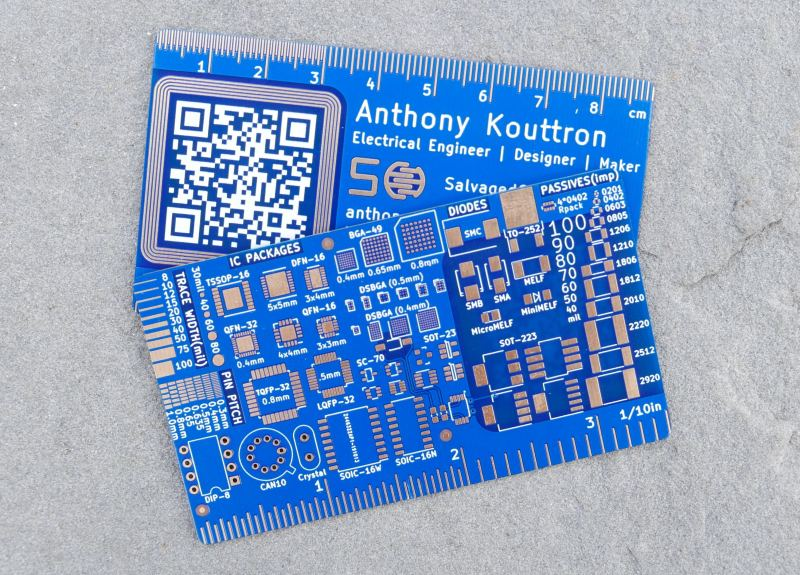

When looking for ideas for business cards, I came upon this one, and thought it was very cool. I really liked its functionality, when most other google search results were about the idea of a PCB, the lack of an idea of a PCB, or very rough. There were some others that were very similar to this, but I think this was the best executed one.

Because of my anger at business cards, I decided to turn it into a ruler! I am keeping the NFC tag thing, and I will have it send my phone to some common website I use, like my github, or a manufacturer. I don't want it to just be a ruler for cm and inches, I want it to be a good ruler for other stuff, so I plan on putting common footprints on the back of it, like the business card.

Right now, I am mainly working on the NFC antenna and supporting circuitry. I want to use a chip that I can hand solder, so I chose a SOIC-8 package. The chip is the ST ST25DV04KC-IE8S3. I chose it because it was quite cheap on LCSC. 

The antenna is quite tricky, as I want to minimize the space it takes up on the ruler. NFC is on a frequency of 13.56 MHz, and NFC antennas should have their resonant frequency at that value. You can calculate the resonant frequency with the following formula:

$$f=\frac{1}{2\pi\sqrt{L\cdot C}}$$

Where:

$L=$ Inductance, in Henries
$C=$ Capacitance, in Farads

The wavelength of 13.56 MHz is ~22 meters; my antenna is not longer than the half wavelength, so I have to tune (primarily) for inductance. The NFC tag has an internal tuning capacitance of 28.5 pF, so I am shooting for 4.83 uH. To calculate the inductance of a square to circular antenna, I chose to use the Current Sheet Approximation

$$L=\mu_{0}\cdot\frac{N^{2}\cdot d_{\text{avg}}\cdot c_{1}}{2}\cdot\bigg[\ln(\frac{c_{2}}{\rho})+c_{3}\cdot\rho+c_{4}\cdot\rho^{2}\bigg]$$

Where:

$\mu_{0}=$ Permeability of free space $=4\pi\cdot10^{-7}\frac{\text{H}}{\text{m}}$

$N=$ Number of turns (not actual turns, loops)

$d_{\text{avg}}=$ Average diameter of the coil $=\frac{d_{out}+d_{in}}{2}$

$\rho=$ Fill ratio $=\frac{d_{out}-d_{in}}{d_{out}+d_{in}}$

$c_{1}\text{, }c_{2}\text{, }c_{3}\text{, }c_{4}=$ Geometry coefficients. Based on shape

There are some already known values for the coefficients for basic shapes, like squares, circles, or hexagons. There is also another formula called the Modified Wheeler Formula. It is more suited for antennas with a higher fill ratio, and the Current Sheet Approximation is a bit better for my trace setup.

Because space was constrained, I also decided to place half of the antenna on the bottom copper layer. This complicates calculations because now,

$$L_{\text{total}}=L_{1}+L_{2}+2M$$

Where:

$M=$ The mutual inductance

For thinner boards, like 0.8mm, a rule of thumb is to multiply the single board apparent inductance by 4. I don't like rules of thumbs, so there is another estimation formula, which is

$$M=k\cdot\sqrt{L_{1}\cdot L_{2}}$$

Where:

$k=$ The coupling coefficient!!!! yyaayaayyyyy.

Because $L_{1}=L_{2}$, The $L_{\text{total}}$ formula can be simplified:

$$L_{\text{total}}=2L(1+k)$$

And you guessed it! There is an approximation formula for k! Assuming each layer is identical,
$$k=1-\frac{X}{1.6+0.12\cdot N}$$

Where:

$X=$ The distance between the two copper layers in mm

If you haven't noticed, these formulas includes a lot of approximation. I have already calculated stuffs using this formula to settle on a 13x13mm square shape with trace width and spacing of 5 mils (I am basically NASA). However, the actual antenna will have slightly rounded corners, a via to switch between the top and bottom layer, traces connecting it to the NFC tag, and surrounding copper that angers it. Furthermore, these calculations do not take into account frequency. For those reasons, I will be using an electromagentic field solver to calculate what will actually be going on in my PCB and what tuning capacitor to place to make the resonant frequency better.

The schematic is extremely simple

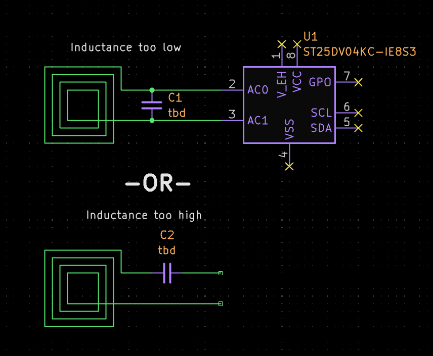

The majority of my time was spent in the PCB editor. This is where I got to

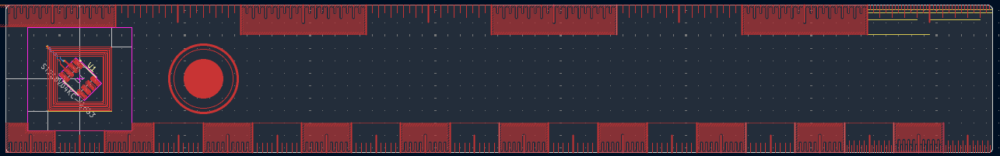

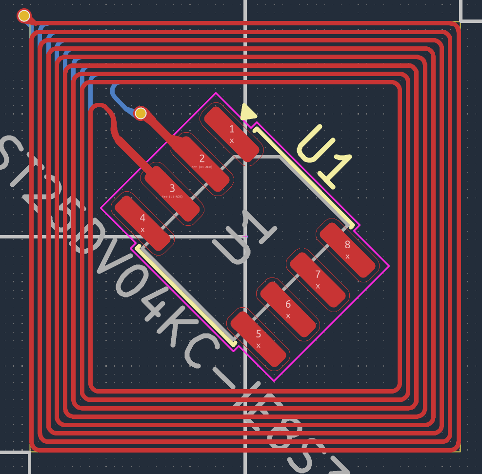

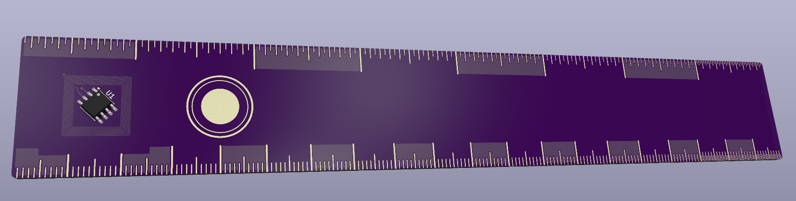

I was thinking about how JLCPCB has a minimum distance from the edge of the board for traces, and I realized that my design would violate that, but I think (**THINK**) I am fine. What really confused me was how Anthony Kouttron was able to do it with his business card. While, yes, I could just do a silkscreen, I find that very boring. What I think I can do is just put in my order notes that I accept the risks of fabricating the board in its current condition. I was looking at castellated edges, but I realized that would be WAY too expensive.

Now all I have left to do is finish the reference footprints and other copper features and run the electromagnetic field solver.

**Time spent: 8h**

___

# October 28, 2026: Recalculation

I realized my calculations were slightly off. I used them exactly as printed, but I could have done some things to account for unaccounted for factors. like accounting for a possible parasitic capacitance of 3 pF. Those slightly nicer approximations change things, increasing the total capacitance to 31.5 pF and the total inductance to 5.03 uH. Because I am tuning my antenna for inductance, the new optimal inductance is 4.35 uH. That is quite far from 5.03, but I don't want to decrease the size of the antenna, as space is already constrained (Chip is in the center). I could decrease the amount of turns, but that would decrease it by too much. I realized, though, that circles have a shorter trace length than squares, so I thought to round of the corners. I settled on an outer radius of 3.5mm, with all of the inner arcs being concentric.

Nevermind, due to the complexity of all this math, I asked chat gpt if my math works out, and it revealed it did not. Through a bunch of fancy maths, it determined that the total inductance decrease from my 3.5mm fillets was about 4%, which is not enough to get the resonant frequency in range. I could make the fillets far more aggressive, but making the fillets was a very time intensive process, as I couldn't just tell KiCad to make concentric fillets and also replace the current, smaller fillets. I am just going to keep the fillets where they are at (I think they look quite cool), and add a tuning capacitor after finding the simulated values of all the stuffs. 

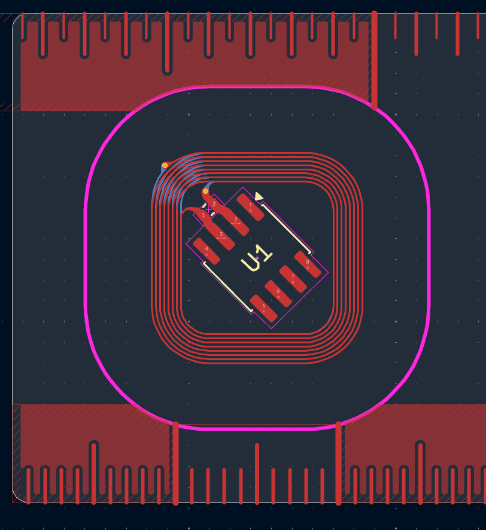

I then realized that the current placeholder resistor is still in the position for an inductance too low, so I switched it to the too high configuration

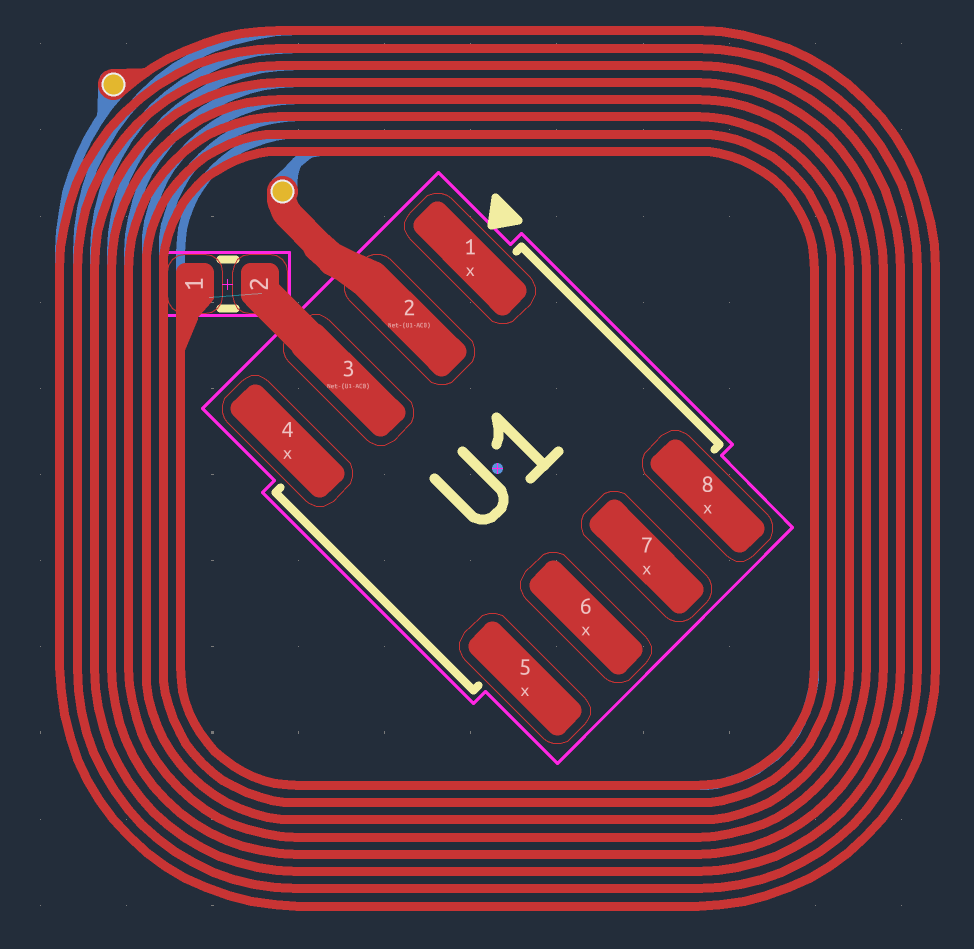

**Total time spent: 3h 30m**

___

# October 30, 2026: Finishing the PCB layout

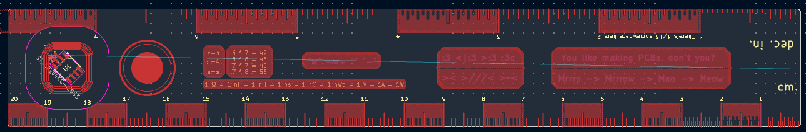

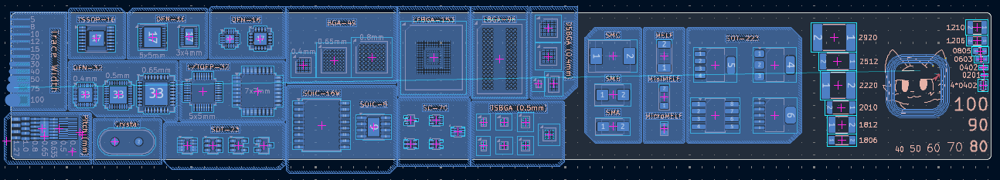

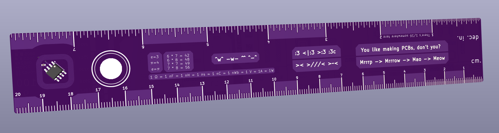

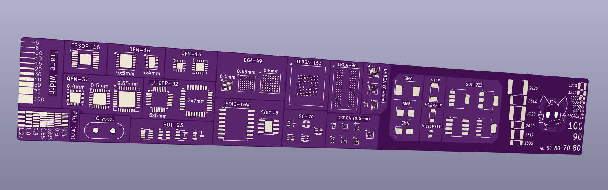

There wasn't anything crazy interesting with today; a lot of the time was just spent on tiny adjustments and repetitive tasks. I added all of the footprints present on the inspiration business card as well as more, such as more QFN and L/TQFP footprints, 1.27mm pitch ruler, eMMC BGA-153 footprint, and BGA-96. On the front of the ruler, I added numbering, labeling, lookup tables, and a motivational quote. I used ground pours to group things. The main name of the group had the pour removed around it to add more contrast.

If you are wondering how I will get the NFC tag to send a URL to a phone, I can use a phone to program it over NFC, so nothing fancy is required.

I began looking into the electromagentic field solver, and it looks like it will be not as annoying as OpenFOAM, as I can use the rfsim plugin for KiCad with EMerge (OpenEMS isn't as good for lower frequencies, like NFC) and it handles a lot of the complex work. I didn't know at first that OpenEMS was for higher frequencies, so I was getting very confused when it kept giving me an error saying that there was no reference plane/pour below the pads I had chosen, even when I had a dummy one. When I just tried using the default GHz level frequencies, the error went away. I don't have EMerge installed yet, so I will be doing that tomorrow.

**Total time spent: 6h 40m**

___

# October 31, 2026: Last day!

I have reached my deadline, so I must finish it today. I won't submit something unfinished, though.

I HATE RFSIM!!!!!!!!!!!!!!

EMerge was very annoying, and then rfsim started spouting some bs about a reference plane to excite the pads to, and then I realized I couldn't differentially excite the pads, which I need to do with the antenna. I am now trying to use EMerge directly, instead of having everything go through rfsim.  
and I wanted to CAD a container if I had time :< 

I hate rfsim even more now. I know I said I wouldn't use it, but it isn't the problem, I kind of was. I now am simulating the NFC tag by bridging the two antenna pads with a 28.5 pF capacitor. I spent nearly an hour troubleshooting why the capacitor wouldn't appear in the lumped elements list until I tried opening rfsim without doing anything to the component. It then showed up! What was the problem, you may ask? The component was rotated 45 degrees. For some reason, that is why it wasn't showing up. I also applied some optimizations, cutting off anything more than 5 cm away from the center of the antenna. After letting it run for a while (like 2 hours), I realized it defaulted to only 1 thread, so I had to restart. If it gets much later I may have to just use the approximated value for reference. I hope note. Sadly, I can't CAD while it is running, as it is eating up all of my resources, except RAM, surprisingly.

I am incredibly displeased to announce that the simulation is taking too long. I am going to just go off an estimate. While this project is being reviewed, I can definitely finish the simulation to find the more exact value. :<  
On the bright side, though, while I was hopefully waiting for the simulation, I found a new font that I really enjoy. It is called Monaspace, and it has 5 versions. I really like Radon and Krypton; Krypton for my terminal emulator and Radon for my writing. A cool thing it does is sort of like ligatures. If a dense character, like m, appears in between less dense characters, like l and i, it will expand to fill more of its block. This doesn't pertain at all to my design, nor was it put on the time, but I thought it was cool.

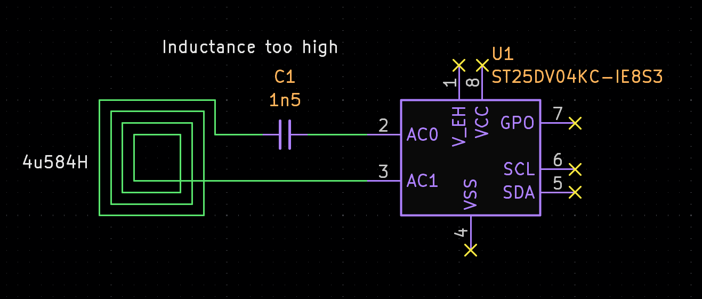

The new estimate is an inductance of 4.584 uH and a total capacitance of 30.6 pF. The tuning capacitor now required is 1.5 nF in series. That capacitor needs to be very accurate, so I hope to use the KEMET C0402C152F5GECAUTO. I say "hope" because there is only 1 in stock. If my review goes okay and it is still in stock, then I will go with it. If it goes out of stock, I will have to switch to a larger footprint, which requires a minor adjustment.

I slightly adjusted the layout of the front of the PCB and began preparing it for shipping. I exported the .step file, which was the perfect time for me to find out I can't click any popups in fusion360, which I had just gotten to work this morning. So now I have to open up my virtual machine, since I don't have the time, nor is it the time, to troubleshoot or reinstall fusion for linux.

I hate virtual machines!!  
I am now reinstalling my virtual windows since I may have bricked the old one.

Yeah a virtual machine is just not working. I am now going to use OnShape. I have no idea how to use OnShape, so please understand that. The step file exported with yellow copper, which is not the case. Aaaaand wonderful, PrtSc isn't working.

I have now gotten I believe everything I need ready to send in for review! I hate tariffs, They brough my full total to $47. Linking my LCSC order to my JLCPCB order may save $16, but still.

I can't shake the feeling that I am missing something

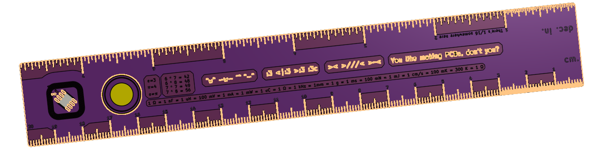

**Total time spent: 8h 20m**