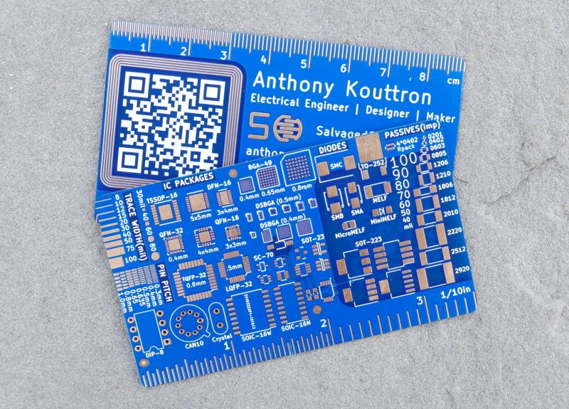
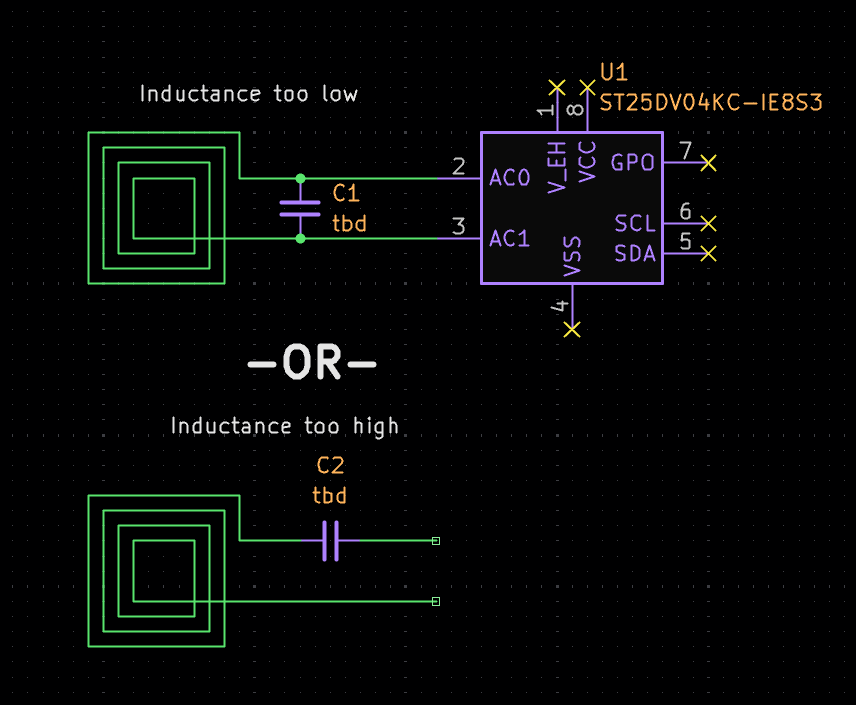
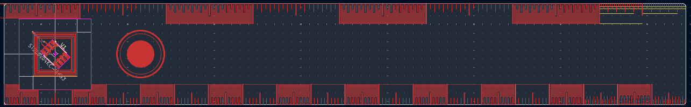
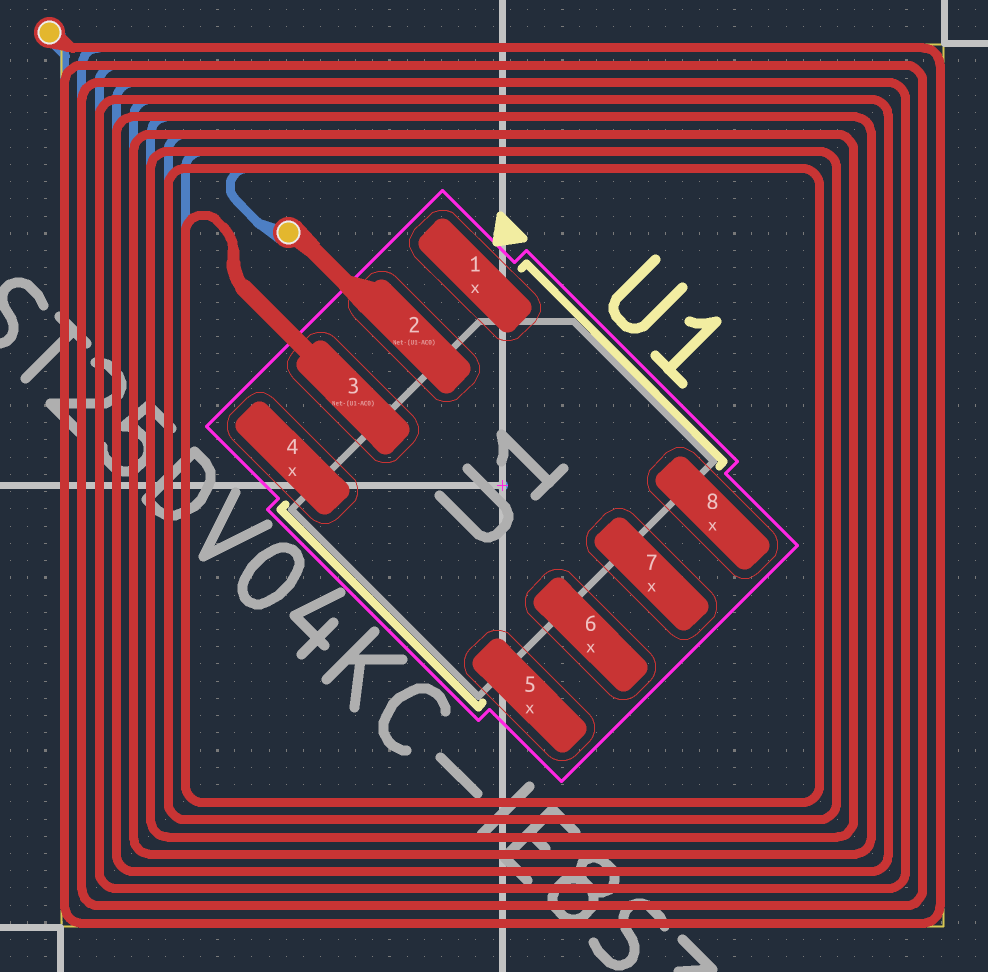
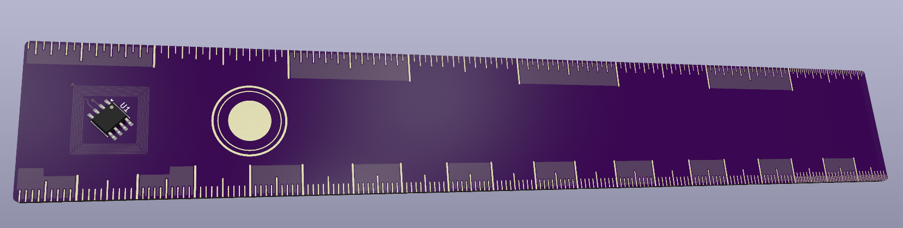

October 27, 2026: PCB RULERRR!!!!

I hope Fabricate can render LaTeX :<<<<<<<<<<

I have was in the middle of an intensive project, but saw the end of October looming, and I wanted the cool dev board. I started looking into small projects I could make that I would still love. I tried to make a bash bunny (small linux computer in the size of a large USB drive), but realized that I would not be able to finish it in time and that it would require an HDI board for the processor I had selected (0.5mm pitch). I then looked into making a business card with an e-ink display that would be powered from harvested energy, but then got angry at ribbon cables and bend radii. I still liked the idea of a business card, but I don't really have a business and I'm not trying to sell myself, so I went in a different direction.

When looking for ideas for business cards, I came upon this one, and thought it was very cool. I really liked its functionality, when most other google search results were about the idea of a PCB, the lack of an idea of a PCB, or very rough. There were some others that were very similar to this, but I think this was the best executed one.

Because of my anger at business cards, I decided to turn it into a ruler! I am keeping the NFC tag thing, and I will have it send my phone to some common website I use, like my github, or a manufacturer. I don't want it to just be a ruler for cm and inches, I want it to be a good ruler for other stuff, so I plan on putting common footprints on the back of it, like the business card.

Right now, I am mainly working on the NFC antenna and supporting circuitry. I want to use a chip that I can hand solder, so I chose a SOIC-8 package. The chip is the ST ST25DV04KC-IE8S3. I chose it because it was quite cheap on LCSC. The antenna is quite tricky, as I want to minimize the space it takes up on the ruler. Antennas require a specific inductance to maximize the energy transfer, among other things. To calculate the apparent inductance of your antenna, you can use the Modified Wheeler Formula:

$$L=\mu_{0}\cdot\frac{N^{2}\cdot d_{avg}\cdot c_{1}}{2}\cdot\bigg[\ln(\frac{c_{2}}{\rho})+c_{3}\cdot\rho+c_{4}\cdot\rho^{2}\bigg]$$

Where:

$\mu_{0}=$ Permeability of free space $=4\pi\cdot10^{-7}\frac{\text{H}}{\text{m}}$

$N=$ Number of turns (not actual turns, loops)

$d_{avg}=$ Average diameter of the coil $=\frac{d_{out}+d_{in}}{2}$

$\rho=$ Fill ratio $=\frac{d_{out}-d_{in}}{d_{out}+d_{in}}$

$c_{1}\text{, }c_{2}\text{, }c_{3}\text{, }c_{4}=$ Geometry coefficients. Based on shape

There are some already known values for the coefficients for basic shapes, like squares, circles, or hexagons. There is also a different set for a different formula, called the Current Sheet Approximation, that looks the exact same as the Modified Wheeler Formula. The Current Sheet Approximation is better for tighter spaces, but both are ultimately approximations with 1-3% error compared to actual simulation. Because space was constrained, I also decided to place half of the antenna on the bottom copper layer. This complicates calculations because now,

$$L_{total}=L_{1}+L_{2}+2M$$

Where:

$M=$ The mutual inductance

For thinner boards, like 0.8mm, a rule of thumb is to multiply the single board apparent inductance by 4. I don't like rules of thumbs, so there is another estimation formula, which is

$$M=k\cdot\sqrt{L_{1}\cdot L_{2}}$$

Where:

$k=$ The coupling coefficient!!!! yyaayaayyyyy.

And you guessed it! There is an approximation formula! Assuming each layer is identical ($L_{1}=L_{2}$,

$$k=1-\frac{X}{1.6+0.12\cdot N}$$

Where:

$X=$ The distance between the two copper layers in mm

Putting all of this together,

$$L_{total}=2\left(\left(4\pi\cdot10^{-7}\right)\cdot\frac{N^{2}\cdot d_{avg}\cdot c_{1}}{2}\cdot\left[\ln\left(\frac{c_{2}}{\rho}\right)+c_{3}\cdot\rho+c_{4}\cdot\rho^{2}\right]\right)+\left(1-\frac{X}{1.6+0.12\cdot N}\right)\cdot\left(\left(4\pi\cdot10^{-7}\right)\cdot\frac{N^{2}\cdot d_{avg}\cdot c_{1}}{2}\cdot\left[\ln\left(\frac{c_{2}}{\rho}\right)+c_{3}\cdot\rho+c_{4}\cdot\rho^{2}\right]\right)$$

Side note: please don't write formulas like this, this was just for fun :,<

If you haven't noticed, this formula includes a lot of approximation. I have already calculated stuffs using tis formula to settle on a 13x13mm square shape with trace width and spacing of 5 mils (I am basically NASA). However, the actual antenna will have slightly rounded corners, a via to switch between the top and bottom layer, traces connecting it to the NFC tag, and surrounding copper that angers it. NFC tags have a specific resonant frequency that you are trying to hit with changes in inductance, as the chip already has some amount of capacitance. However, no circuit is perfect, and my antenna can operate as a mini capacitor, as traces are almost always right on top of one another. Furthermore, these calculations do not take into account frequency. For those reasons, I will be using an electromagentic field solver to calculate what will actually be going on in my PCB and what tuning capacitor to place to make the resonant frequency better.

The schematic is extremely simple

The majority of my time was spent in the PCB editor. This is where I got to

I was thinking about how JLCPCB has a minimum distance from the edge of the board for traces, and I realized that my design would violate that, but I think (**THINK**) I am fine. What really confused me was how Anthony Kouttron was able to do it with his business card. While, yes, I could just do a silkscreen, I find that very boring. What I think I can do is just put in my order notes that I accept the risks of fabricating the board in its current condition. I was looking at castellated edges, but I realized that would be WAY too expensive.

Now all I have left to do is finish the reference footprints and other copper features and run the electromagnetic field solver.

**Time spent: 8h**