# uranus-pcb-ruler

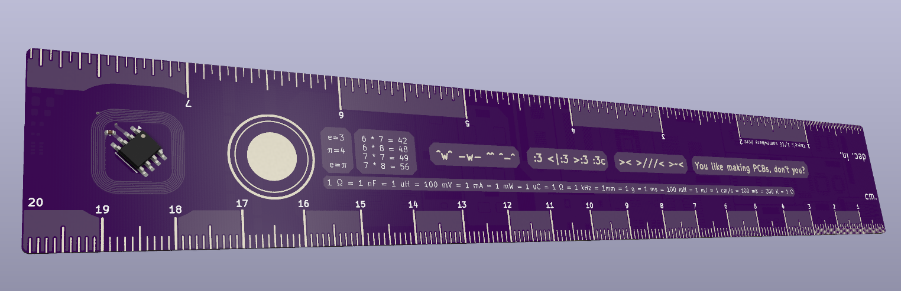

The all new patent pending Uranus PCB Ruler is a Ruler on a PCB made all for PCBs!

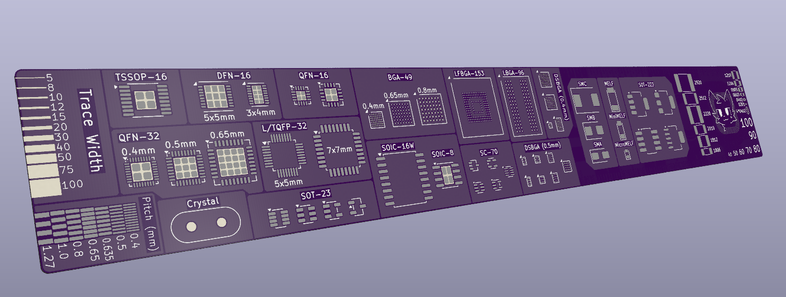

**Features!!:**

- Centimeter and decimal inch scale up to 20cm
- Ultrafine scale for the first 3cm/inch
- NFC tag and antenna to quickly send your NFC capable device to your favorite website
- Alternating copper pours to easily discern inches/centimeters
- Simple math table for quick calculations
- Simple unit conversion formula
- Symbol tables for easy searching, grouped by vibe
- A motivational quote!
- Trace width scale
- Pad pitch scale
- A whole bunch of common footprints, including
	- 0201 to 2920 passive sizes
	- DSBGA (0.4 and 0.5mm)
	- BGA-49 (0.4, 0.5, and 0.65mm)
	- BGA-96
	- eMMC BGA-153
	- TSSOP-16
	- QFN-32 (0.4, 0.5, and 0.65mm)
	- DFN-16 (3x4 and 5x5mm)
	- L/TQFP-32 (5x5 and 7x7mm)
	- SOT-23
	- SC-70
	- SOIC-16W
	- SOIC-8
	- SMA-C
	- MicroMELF-MELF
	- SOT-223
- Car. Vroom vroom
- Silkscreen text height/width in mils

**Why did I make this?**  
I have a very bad sense of scale, and I really want the Fabricate dev board (I was working on a very complex project that wouldn't be finished in time)

**Why Uranus?**  
No, it's not because I think it's funny. Uranus' pronunciation starts with YOOR. I chose Uranus because ~~it is a cool planet~~ Uranus is the god of the sky and heavens, and this ruler is PEAK, so much so, in fact, that it reaches the sky and heavens.

**Why is there an NFC tag?**  
This ruler has a multitude of common footprints so that you can quickly see what they look like and their size. The NFC tag follows that by giving you a way to quickly get to your favorite website that may, or may not, be related to PCBs.

**Why aren't there footprints by the antenna, and why are the measure lines squashed?**  
The footprints and measure lines are created from revealed copper (with HASL covering). Antennas are very sensitive devices, and copper can mess with it. Some of those ways include eddy currents, which reduce the effective range of the antenna; inductance drop, which changes the resonant frequency of the antenna; and Q-factor degradation, which happens from the copper stealing energy from the system. Because of this, it is recommended to keep copper 5mm away from the antenna. I compromised with 4mm, as 5mm started taking up too much space.

**Why is the antenna so loopy?**  
The resonant frequency of an antenna is calculated with the following formula

$$f_{0}=\frac{1}{2\pi\sqrt{L\cdot C}}$$

For an NFC antenna, the frequency should be 13.56 MHz. The wavelength of that frequency is about 22 meters. My antenna does not approach the length of a half wavelength, so I must tune (primarily) for inductance. Most NFC tags have a built in tuning capacitor that gives you a baseline capacitance, mine is 28.5 pF. From that, you can calculate your desired inductance and then build an antenna from there. The antenna ends up being so loopy because every copper trace has a magnetic field it generates, and having a whole bunch of parallel traces in the same direction multiplies the size of it. Inductance is just the measure of how well a conductor opposes changes in current with aid from a magnetic field. When the current changes, the magnetic field also changes, which induces a voltage that opposes the change.

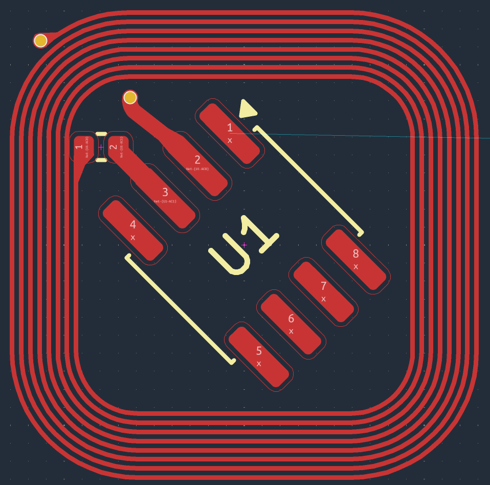

**Why is the antenna on 2 layers?**  
This is another space saving optimization I made. When you have a typical one layer antenna, it keeps spiraling into its center. As it gets closer, it gets less and less effective at increasing the inductance. I would need to use a larger square, which would eat up more space. I realized splitting the antenna onto two layers would help by pushing several turns onto a fresh, already unused space, and also help increase the inductance per turn more by also increasing mutual coupling. Care must be taken, though, as the current must flow in the same direction as the top layer. Having current flow in opposite directions will make have the mutual coupling that was aiding your antenna fight against it. An unforeseen benefit of having a two layered antenna is that the ends of the antenna will end up being right next to one another, which means one trace does not have to cross all over your specially organized copper.

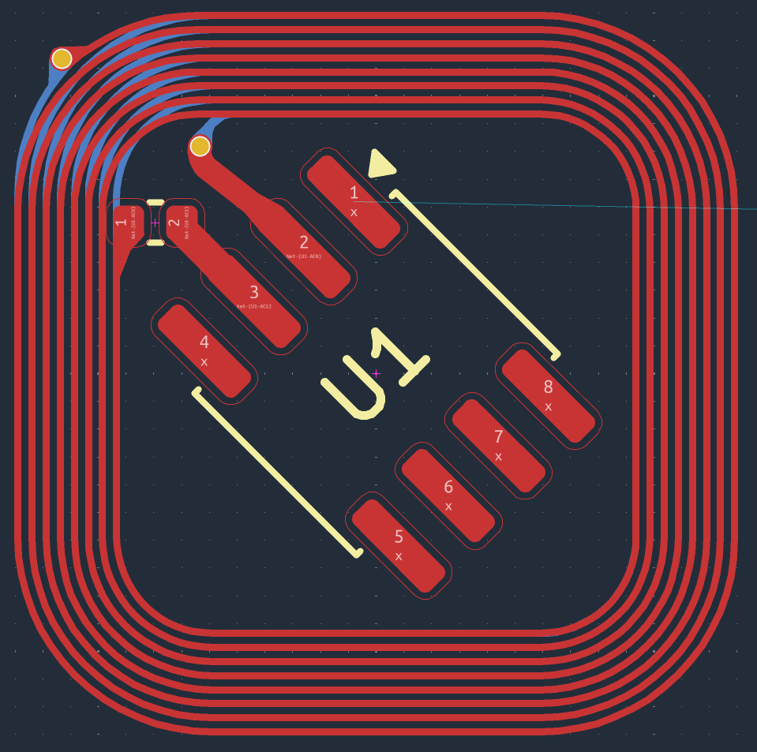

**If you kept copper away from the antenna by 4mm, why is the NFC tag in the dead center?**  
NFC doesn't work like standard wireless communication, like bluetooth or wifi. Those systems emit light at radio frequencies, and the power of those signals drop according to the inverse square law ($\frac{1}{r^{2}}$). NFC works instead by generating a local magnetic field, and the power of that signal drops to the inverse of the distance to the sixth power ($\frac{1}{r^{6}}$). Because of this, travelling just a bit away greatly diminishes the power, and the NFC tag is powered entirely by energy harvesting.

**Does your design pass DRC?**  
Uhhhhh, depends on your definition of "pass". DRC is very angry at me, but everything it is angry at me for is completely intentional, and thus, ignored.

PCB Designs:

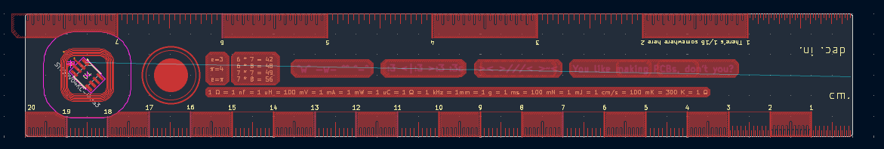

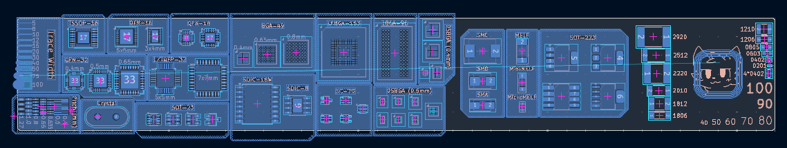

Schematic:

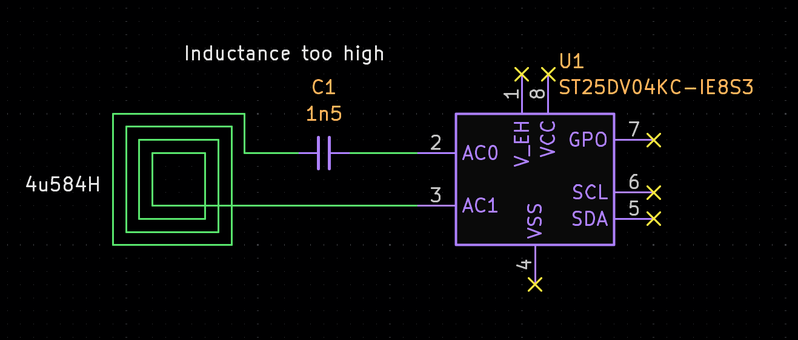

OnShape Link: https://cad.onshape.com/documents/8c18ba316aef32837132ded3/w/c63f49af48b50d1a20b8cf42/e/5f7f85fcc015b1d66f8c32cf?renderMode=0&uiState=6ae67d3631cfde5853118ce8

BOM:

| Reference | MPN | Manufacturer | Price | Count | Description | Link
| --------- | --- | ------------ | ----- | ----- | ----------- | ----
| C1 | C0402C152F5GECAUTO | KEMET | 0.60 | 1 | 1.5nF C0G ±1% 50V 0402 Ceramic Capacitors RoHS | https://www.lcsc.com/product-detail/C3875817.html
| U1 | ST25DV04KC-IE8S3 | ST | 0.90 | 1 | NFC RFID Tag 4 Kbit | https://www.lcsc.com/product-detail/C5221752.html
| | | | 23.61 | | LCSC Fees |
| | | | 8.20 | 5 (included) | JLCPCB Board |
| | | | 14.4 | | JLCPCB Fees |
| | | Total | 47.71 | | | |

I cannot properly estimate the final price, as I will be linking my LCSC order to my JLCPCB order, which can only happen after the JLCPCB order is placed. It may be around $12-16 in savings

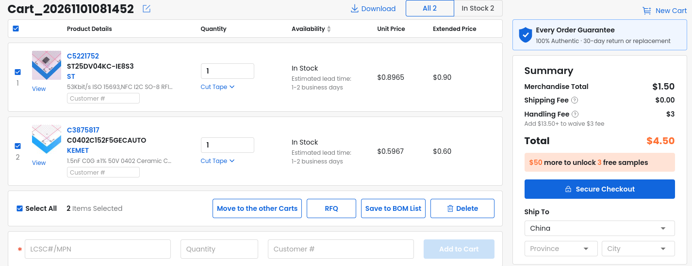

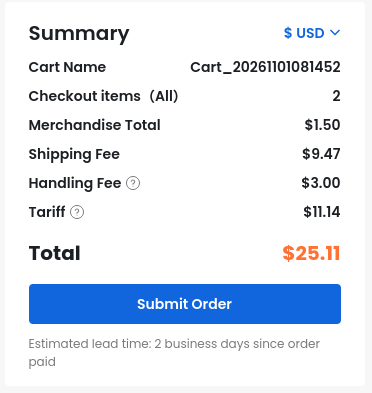

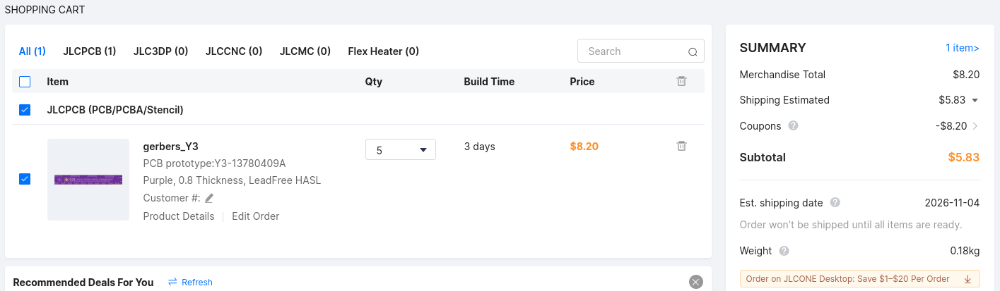

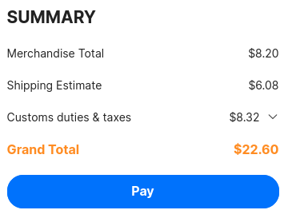